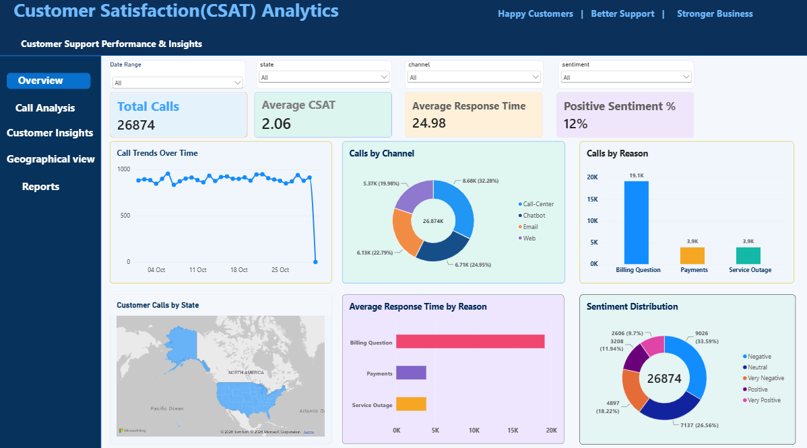

CSAT Analytics Project

## Project Overview

The CSAT Analytics project focuses on analyzing customer satisfaction and call center performance using data analytics tools.

## Tools and Technologies

- Python
- NumPy
- Pandas
- Matplotlib
- MySQL
- Microsoft Excel
- Power BI

## Project Workflow

1. Data collection
2. Data cleaning and preprocessing
3. Exploratory Data Analysis (EDA)
4. SQL queries for data analysis
5. Dashboard development using Power BI
6. Customer satisfaction analysis

## Project Files

- CSAT.ipynb – Python analysis
- csat_sql.sql – SQL queries
- csat1.dashboard.pbix – Power BI dashboard
- CSAT_DATASET1.xlsx – Excel dataset
- CSAT_Dataset.csv – CSV dataset
- CSAT_Analytics_Project_Presentation.pptx – Project presentation

## Project Objective

To analyze customer satisfaction, identify trends, evaluate call center performance, and generate useful insights through interactive visualizations.

## Dashboard Preview

## Conclusion

This project helps understand customer satisfaction levels and supports better decision-making through data analytics.
